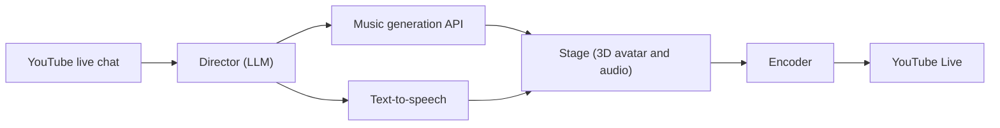

# LaiVE

**AI-hosted live streams where the audience shapes the show.**

LaiVE runs interactive live streams on YouTube that are hosted by an AI character. Viewers post comments in the live chat, and the stream changes in response. The first program is a live music show: an AI "composer" turns viewers' comments into original songs, thanks each viewer by name, and plays the result on air.

> **Status:** early stage. A feasibility study is done and the prototype is not built yet. LaiVE is a personal project by an individual developer in Japan.

## What a viewer sees

1. A viewer posts a request in the chat, for example "a city pop song about rainy Mondays".
2. The composer, a 3D avatar with a voice and facial expressions, picks the comment and says what it is going to write.
3. A few minutes later the song is ready. The composer thanks the viewer by name, explains how the comment shaped the song, and plays it.
4. The next comments shape the next song.

The music is made live with the audience, not chosen from a catalog. That is the experience LaiVE is built around.

## Design

- **Director** reads the chat every few minutes, selects comments, and writes the song prompt, the lyrics, and the composer's lines.
- **Music generation** turns the prompt and lyrics into a finished song.
- **Stage** is a web page that renders the avatar, lip-syncs the speech, and plays the song.
- **Encoder** captures the stage and sends it to YouTube.

Each stream will run in its own container on AWS and stop billing when the stream ends. The design allows several streams to run at the same time.

## Music generation

Songs are the core of the show. LaiVE talks to the music engine through a small interface: a prompt and lyrics go in, audio comes out. Suno is the engine LaiVE aims to use for vocal songs, pending API access.

Expected usage:

- 10 to 20 songs per stream hour, one request per song
- Server-side requests only, made by the director
- Songs are played on the live stream, with the requesting viewer credited on screen

LaiVE uses official APIs only. It does not scrape websites or use unofficial wrappers.

## Planned safeguards

Chat comments are untrusted input, so they will not reach a model or a music engine unchecked.

- Comments are filtered and rewritten before use. Requests that name real artists or quote existing lyrics are not passed through.
- Each viewer and each stream has an hourly limit on the songs it can trigger.
- Streams are labeled as AI-generated.

## Roadmap

- [ ] Local prototype: the avatar speaks and plays a song on an unlisted YouTube stream
- [ ] Comment-to-song loop with a music generation API
- [ ] Deployment on AWS, with start and stop from a web console
- [ ] Multiple concurrent streams
- [ ] More program types beyond music

## Contact

Questions and feedback are welcome in this repository's issues.
